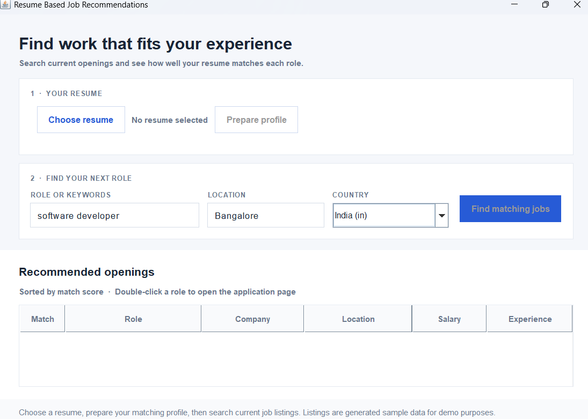

# Job Recommendation System

A small desktop job hunting tool. It reads a resume on your computer, generates a set of sample job listings, ranks them against your extracted skills and experience, and shows a match score. Results show match scores without listing the detected or missing skill names.



## What it does

- Reads text based PDF, DOCX, DOC, and TXT resumes.
- Reads PNG, JPG/JPEG, TIFF, and BMP resumes with a bundled local OCR engine. Scanned PDFs use the same local OCR fallback (up to 20 pages).
- Extracts skills across the full resume and job description, using aliases such as `JS`/`JavaScript`, `K8s`/`Kubernetes`, and `Amazon Web Services`/`AWS`. It also matches unfamiliar skill names when they appear in explicit `Skills:` sections.
- Detects explicitly stated experience years, compares them with years stated in job descriptions, and shows the result separately from the skill match score.
- Generates randomized sample job listings for a role/keywords, location, and country, and ranks them against your resume. Double click a result to open its (placeholder) application link.

The resume is processed entirely locally and is never uploaded anywhere.

## Run it

Requirements: Java 17 or newer. The Maven Wrapper downloads Maven and the project's libraries on first build.

1. **JiaJiaOCR engine (required to build):** not published to Maven Central. Download [`JiaJiaOCR-1.0.2.jar`](https://github.com/jiangnanboy/JiaJiaOCR/releases/download/JiaJiaOCR/JiaJiaOCR-1.0.2.jar) and place it at `lib/JiaJiaOCR-1.0.2.jar` (the `lib/` folder is gitignored — the jar is ~22 MB and not committed).
2. Build the self-contained app:

   ```powershell
   .\mvnw.cmd clean package
   ```
3. Launch it:

   ```powershell
   java -jar target/job-recommendation-system-1.0.0.jar
   ```

## Use it

1. In **Your resume**, choose a PDF, DOC, DOCX, TXT, or supported image resume, then select **Prepare profile**. The profile is prepared locally; the app shows a short readiness summary without exposing a skill list.
2. In **Find your next role**, enter a role or search phrase and location, choose a country, then select **Find matching jobs**.
3. Compare the weighted match percentage and experience note. Double click a row to open the listing.

## How matching works

The results show a match score and experience note without displaying extracted or missing skill lists. The score weights required skills twice as much as preferred skills. When both resume and job state experience years, the final score combines 80% weighted skill overlap with 20% experience fit; otherwise it uses the skill score alone. Skill overlap includes known aliases plus unfamiliar terms found under explicit skills headings. The matcher also ignores common negative wording such as "no experience with Java."

This is a transparent rules based score, not an AI hiring decision or a guarantee of qualification.

## Project structure

- `JobRecommendationApp` — Swing user interface and background tasks
- `ResumeService` — local text/OCR parsing, skills, and experience extraction
- `AdzunaJobSearch` — generates randomized sample listings (see **Key decisions**)
- `JobMatcher` — skill overlap ranking and experience comparison
- `Job` / `JobMatch` — typed domain records

The OCR package is JiaJiaOCR 1.0.2, distributed under Apache License 2.0. The app uses it locally and does not send resume images to any external OCR service.

## Key decisions

- **Sample data instead of a live job API.** The app used to call Adzuna's search API, requiring API credentials and network access. It now generates randomized sample listings locally (`AdzunaJobSearch`, kept under its original name so the rest of the app is unchanged). No credentials, no network calls, no rate limits — useful for demos and development.
- **Repository history was rewritten.** The repo previously carried duplicated nested project copies, committed `.zip` archives, and dead scaffolding from earlier prototyping. History was squashed to a single clean commit containing only the working app.
- **`pom.xml` was broken and has been fixed.** It pointed at an abandoned package (wrong `groupId`/`mainClass`, a non-existent `anyvalue:pdfbox-app` artifact) and was missing dependencies the real app needs (Jackson, PDFBox, OpenCV, ONNX Runtime, DJL) to actually compile and run. It now builds a self-contained jar via `maven-shade-plugin`.

## License

JiaJiaOCR is distributed under the Apache License 2.0 by its upstream project.
